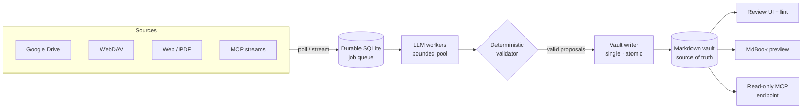

# SaussuNet

> **Feed raw sources. Get a living wiki.**

SaussuNet is a self-hosted Rust server that **builds and maintains knowledge vaults** in [llm-wiki](https://gist.github.com/karpathy/442a6bf555914893e9891c11519de94f) format — standard, Obsidian-compatible Markdown — from the sources you already have: Google Drive, WebDAV, web pages, PDFs, MCP streams. It watches, extracts, links, and lints **continuously**, so the vault compounds on its own. **No manual note writing.**

The human is the reviewer, not the writer.

## Why "SaussuNet"

A nod to **Saussure** — semiology: a sign is defined by its relations within a system, not by its substance. A note is a sign: its meaning comes from the wikilinks that bind it to every other note. SaussuNet grows that system of signs on its own. *Signifier × network.*

## The Vision

Most "AI note-taking" tools give you a chat box and a blank page. SaussuNet takes the opposite bet:

- **Your knowledge should compound, not rot.** Sources change; the vault notices. A watched folder, a Drive account, a page you submitted last spring — everything stays current, with provenance back to the raw evidence.
- **The vault is plain files, forever.** No proprietary format, no database you must trust, no lock-in. The Markdown vault *is* the system of record — openable in Obsidian unchanged, servable by [MoriNet](https://github.com/lejeunecedric/MoriNet) unchanged. Delete the database and you lose nothing but cache.
- **Automation you can trust needs a human gate.** Every generated page carries provenance markers; destructive changes (create / merge / archive) wait in a review queue with diffs. Contradictions are **flagged, never auto-resolved** — an LLM silently "fixing" your knowledge is an anti-feature.
- **Your machine is enough.** The LLM provider is abstract: a local model on a Strix Halo box (ROCm) or any OpenAI-compatible API. One binary, SQLite, zero external services.

## How It Works



The **vault filesystem is the truth**; SQLite holds only rebuildable state (queue, sync tokens, registries). The LLM never writes to disk — every page passes a deterministic validator (link whitelist, frontmatter schema, provenance present) before a single byte is written.

### The vault format (llm-wiki)

```
vault/
├── SCHEMA.md      # the vault's own constitution: types, tags, thresholds
├── index.md       # catalog entry point, sized to fit a context window
├── log.md         # append-only journal of every change
├── raw/           # immutable evidence layer (sha256-tracked sources)
├── entities/      # entity pages — full frontmatter, ≥2 outbound wikilinks
└── concepts/      # concept pages
```

### Non-negotiables

| Guarantee | Mechanism |
|---|---|
| A crash never leaves a half-written page | Single writer task, temp-file + atomic rename |
| Your hand edits are never overwritten | Per-section `gen_hash` three-way merge — divergent pages route to review instead of being clobbered |
| No hallucinated knowledge | Provenance (`^[raw/…]`) required on generated claims; broken links rejected pre-write |
| No feedback loop | Only `raw/` is evidence; watchers refuse vault-internal paths |
| MCP sources stay streams | The vault stores **pointer notes** (addresses), never copies of remote content |

## Two Ways to Live

- **Standalone** — one binary: web UI for configuration, pipeline monitoring, and review; mdBook preview; read-only MCP endpoint at `/mcp`.
- **Library** — `saussunet-core` is a transport-free Rust crate (zero axum) that MoriNet can embed: SaussuNet **builds** vaults, MoriNet **serves** them.

## Roadmap

| Phase | Deliverable | Status |
|---|---|---|
| 1 | Workspace, SQLite store, single atomic vault writer, edit protection | 🔨 in progress |
| 2 | Abstract `LlmProvider` (mock + OpenAI-compatible), crash-safe job queue | ⏳ |
| 3 | Extraction pipeline: URL/PDF → validated, deduplicated, provenance-carrying pages | ⏳ |
| 4 | Continuous watching (WebDAV first) — the vault updates itself | ⏳ |
| 5 | Health lint + review queue + monitoring UI | ⏳ |
| 6 | Read-only MCP exposure, mdBook preview, deploy to `morinet.treklair.fr/saussunet` | ⏳ |

Built with disciplined GSD planning workflows — every phase has context, plans, and verification artifacts in [`.planning/`](.planning/).

## Stack

Rust · tokio · axum · sqlx (SQLite, WAL) · rmcp · askama + htmx (SSR, zero node toolchain) · pulldown-cmark · serde_yml — one static binary, localhost binds by default.

## Quickstart

```bash
cargo build --release
./target/release/saussunet init-vault   # or bare run: creates ./data/vaults/1 + saussunet.db (WAL)
./target/release/saussunet write-page --path concepts/demo.md --from demo.md
./target/release/saussunet conflicts    # human-edit conflicts awaiting review
./target/release/saussunet reindex      # rebuild SQLite from the vault files (D-01)
./target/release/saussunet init         # write a config.toml template
bash scripts/check.sh                   # fmt + clippy -D warnings + tests + guards + release build
```

`demo.md` — llm-wiki pages need full frontmatter and ≥2 outbound wikilinks:

```markdown
---
title: Demo Page
created: 2026-10-25
updated: 2026-10-25
type: concept
tags: [technology]
sources: [raw/articles/demo.md]
---

A demo concept. See [[alpha]] and [[beta]].
```

## Decisions (Phase 1)

- **sqlx pinned 0.8** (resolves 0.8.6): MoriNet alignment for library interop (QUAL-05) — see [SKELETON.md](.planning/phases/01-workspace-foundations-vault-writer/SKELETON.md).
- **CLI-only operability until Phase 5**: Phase 1 opens no listener; the resolved config pins the `bind` default to `127.0.0.1`.
- **Vault FS is truth; SQLite is a rebuildable projection** (D-01): `reindex` rebuilds `page_registry` from the files — deleting the DB costs zero content.
- **One vault shipped, multi-vault-ready** (D-03/D-04): config, schema, paths, and store APIs all carry a vault id.

## License

MIT — see [LICENSE](LICENSE).
